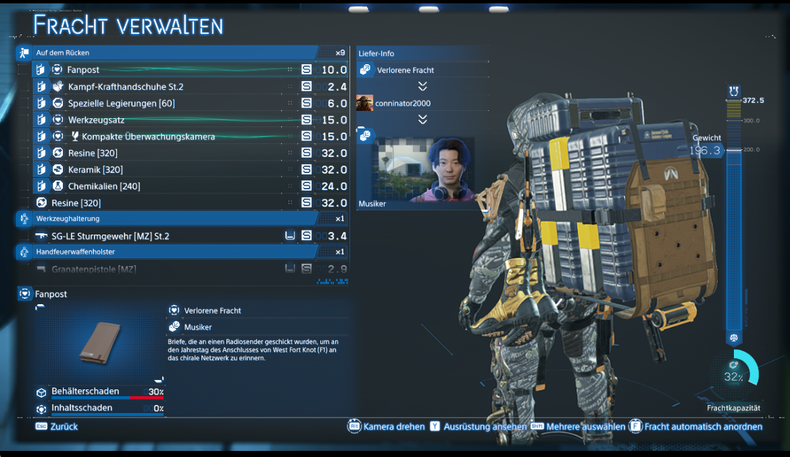
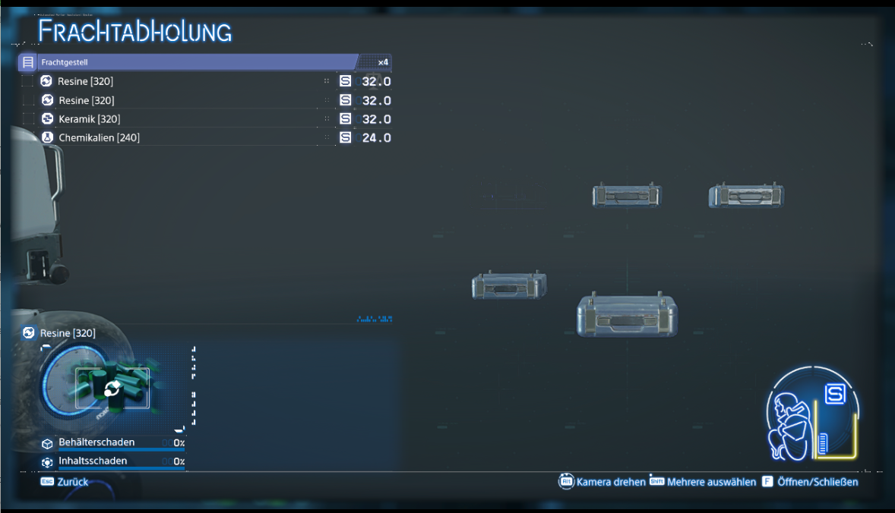

# All Containers Small

Standard cargo containers become **size S**, use one size unit and appear as compact small cases. Material amounts and weight stay unchanged. Includes material containers, ladders, PCC packages and ordinary packaged equipment.

[Download on Nexus Mods](https://www.nexusmods.com/deathstranding2onthebeach/mods/98) · [GitHub release](https://github.com/gutzufuss1477/DS2-Mods/releases/tag/all-containers-small-v1.0.0) · [Deutsche Anleitung](docs/README_DE.txt)



Resins [320] still contains 320 materials and weighs 32 kg. The container is simply size S. This does not increase Sam's weight limit.

## Installation

Requires Windows x64, the supported **Steam DS2.exe 1.10.89.0** and a working [x64 ASI loader](https://github.com/ThirteenAG/Ultimate-ASI-Loader), which is not included.

1. Close the game.
2. Keep your existing ASI loader if it already works.
3. Extract `ds2_all_containers_small.asi` beside `DS2.exe`.
4. Start the game normally and load your save. No INI or hotkey is needed.

The optional `install.ps1` verifies the executable and payload hashes and backs up an older ASI. See the [English instructions](docs/README.txt) or [German instructions](docs/README_DE.txt).

## Exceptions

Floating Carriers/EnemyCart, captured animals and their cages, BB pods/prototype, bodies, vehicles, Coffinboard, GhostMech guns and certain scripted/non-cargo entities keep their original definitions and models. Human/Coffinboard volume classes are also preserved. These objects require their own functional components. Ladder and PCC packages remain included in the S conversion.



## Verification and compatibility

The author confirmed startup, cargo collection, S size labels in inventory, unchanged displayed weights and compact backpack cases on 12 November 2026. The gallery contains the supplied, unaltered gameplay screenshots. Public version **1.0.0** uses that confirmed 0.1.1 runtime with only its version log string changed.

Seventeen local tests passed. Full evidence scope and remaining limits are in [VALIDATION.md](VALIDATION.md). Every deployment path, long-session behavior and saving/reloading repacked cargo have not been comprehensively tested. Exact executable identity and hook checks prevent activation on unsupported builds or conflicting hooks. Compatibility with every other mod is not guaranteed.

Supported executable SHA256: `bf3d1c665545930bc850d8f5df486f7395885bb729d4fd408fdb03390de0765b`.

To remove the mod, close the game and remove its ASI. Original sizes apply after restarting. Arrange cargo to fit its original sizes before removal. The EXE and game archives are not modified on disk; the game continues its normal saving behavior.

## Source and build

The ASI is built with LLVM clang-cl/lld-link on Windows x64 and imports only Kernel32. From this folder:

```powershell
.\build.ps1
```

Output: `release/ds2_all_containers_small.asi`.

Maintainer tests require Python with Capstone and your own local, matching game inputs. These proprietary inputs are not included. Set `DS2_EXE` to the supported executable, `DS2_TYPES` to the matching Odradek RTTI types JSON and `DS2_RESOURCE_DIR` to the exported `DSGameBaggageListItem_*.json` directory. Then run:

```powershell
.\test.ps1 2>&1 | Tee-Object -FilePath build/tests-1.0.0.log
.\package.ps1
```

The tests execute selected native instructions in a separate test process; they do not launch or attach to the game. No game binaries/resources, crash dumps, private logs, credentials or old test releases are included in this source folder. See the repository's [license scope](../../LICENSES.md).

AI was used for code, test and documentation development under the author's direction. Gameplay verification and screenshots were supplied by the author. [Support the author's mods](https://ko-fi.com/gutzufuss).
